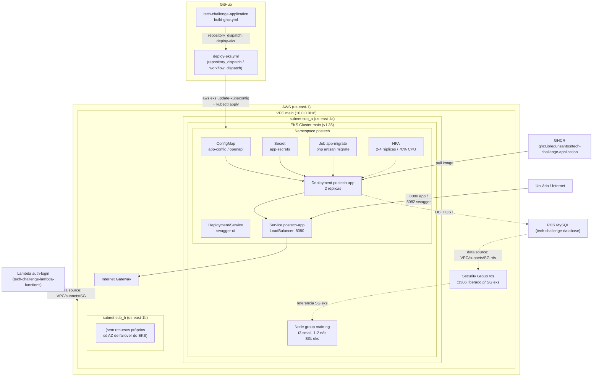

# tech-challenge-kubernetes

## Propósito

Este repositório provisiona a **infraestrutura de rede e o cluster Kubernetes
(AWS EKS)** onde o sistema POS roda em produção, e mantém os manifests
Kubernetes que fazem o deploy da aplicação
[`tech-challenge-application`](https://github.com/eduNsantos/tech-challenge-application)
e do Swagger UI dentro desse cluster.

Ele é o **alvo real de deploy** do sistema: a VPC, as subnets e os security
groups criados aqui são consumidos (via `data source` do Terraform) pelos
repositórios [`tech-challenge-database`](https://github.com/eduNsantos/tech-challenge-database)
(RDS) e [`tech-challenge-lambda-functions`](https://github.com/eduNsantos/tech-challenge-lambda-functions)
(função de login). O `infra/` dentro do próprio `tech-challenge-application`
sobe apenas um Minikube local para desenvolvimento — não faz parte deste
fluxo de produção.

## Tecnologias utilizadas

| Categoria | Tecnologia |
| --- | --- |
| Infraestrutura como código | Terraform (`hashicorp/aws` ~> 6.0) |
| Provedor cloud | AWS (região `us-east-1`) |
| Rede | VPC, subnets públicas, Internet Gateway, Security Groups |
| Orquestração de contêineres | AWS EKS 1.35 + node group EC2 (`t3.small`, 1–2 nós) |
| Manifests de aplicação | Kubernetes YAML puro (Namespace, ConfigMap, Secret, Deployment, Service, HPA, Job) |
| Registro de imagens | GitHub Container Registry (GHCR) |
| CI/CD | GitHub Actions (`.github/workflows/deploy-eks.yml`) |
| CLI/tooling de deploy | `aws-cli`, `kubectl`, `yq` |

## Escopo

### Terraform (infraestrutura)

| Arquivo | Recurso |
| --- | --- |
| `vpc.tf` | VPC `main` + 2 subnets públicas (`sub_a`, `sub_b`) |
| `internet-gateway.tf` | Internet Gateway + rota pública |
| `security-groups.tf` | Security Groups `eks` (tráfego interno + portas 8080/8082 liberadas para IP fixo) e `rds` (o mesmo referenciado como `data source` por [`tech-challenge-database`](https://github.com/eduNsantos/tech-challenge-database)) |
| `eks.tf` | Cluster EKS 1.35 + node group (`t3.small`, 1–2 nós) + IAM roles/policies do cluster e dos nodes |

### Kubernetes (aplicação)

| Manifest | Função |
| --- | --- |
| `k8s/00-namespaces/namespace.yaml` | Namespace `postech` |
| `k8s/01-config/configmap.yaml` | Variáveis de ambiente da app Laravel (`DB_HOST` aponta para a RDS de `tech-challenge-database`) |
| `k8s/01-config/openapi-configmap.yaml` | ConfigMap com o `openapi.yaml` servido pelo Swagger UI |
| `k8s/examples/secret.example.yaml` | Modelo do Secret `app-secrets` (`APP_KEY`, `DB_PASSWORD`, `JWT_SECRET`, `MAIL_*`) — nunca commitar o real |
| `k8s/02-app/app-deployment.yaml` | Deployment da app Laravel (2 réplicas, probes em `/health`) |
| `k8s/02-app/app-service.yaml` | Service `LoadBalancer`, porta 8080 |
| `k8s/02-app/app-hpa.yaml` | HPA: 2–4 réplicas, alvo 70% de CPU |
| `k8s/02-app/migrate-job.yaml` | Job de `php artisan migrate`, rodado a cada deploy |
| `k8s/02-app/swagger-deployment.yaml` + `swagger-service.yaml` | Swagger UI servindo o `openapi.yaml` |
| `app-lambda/` | Terraform das Lambdas da aplicação: `postech-outbox-publisher` (outbox → filas do Services MS) e `postech-execution-consumer` (fila de execução → aplicação) |

### Lambdas da aplicação (`app-lambda/`)

Os workers do monólito rodam em Lambda (PHP 8.4 via Bref 3), com state próprio
(`application-lambda/terraform.tfstate`). O job `lambdas` do `deploy-eks.yml`
roda depois das migrations:

1. Roda `scripts/build-lambda.sh` dentro da imagem `ghcr.io/edunsantos/tech-challenge-application:<tag>`, a mesma do EKS, e gera `build/lambda` (sem dependências de dev).
2. Roda `terraform test` (provider mockado) e `terraform plan` com `TF_VAR_db_password` (`DB_PASSWORD`) e `TF_VAR_app_key` (`APP_KEY`).
3. Remove os Deployments antigos `postech-outbox-publisher` e `postech-execution-consumer` e aplica o plano.

As filas pertencem ao Services MS e são lidas por data source, então o Terraform
do Services MS precisa ter sido aplicado antes. Cada Lambda tem uma role
própria com acesso mínimo à sua fila. As Lambdas rodam fora da VPC e acessam o
RDS público do laboratório (`techchallenge-rds`).

## Arquitetura



- **Rede:** uma única VPC (`main`) com duas subnets públicas em AZs
  diferentes (alta disponibilidade do EKS); o Internet Gateway expõe o
  LoadBalancer do Service da aplicação.
- **Cluster:** o node group EC2 roda todos os pods do namespace `postech`
  (app Laravel, Swagger UI e o Job de migration, este último efêmero a cada
  deploy).
- **Fronteira com os outros repositórios:** os Security Groups `eks` e `rds`
  e a VPC são criados aqui e apenas **lidos** (`data source`, nunca
  recriados) pelos repositórios `tech-challenge-database` e
  `tech-challenge-lambda-functions`.

## Passos para execução e deploy

### State Terraform e migração

A configuração principal usa temporariamente o backend local, com state em
`terraform.tfstate`. O arquivo e seus backups são ignorados pelo Git; mantenha
cópias de segurança protegidas e não os envie ao repositório. A alteração do
backend não recupera nem migra automaticamente um state existente: confirme
conta, permissões e state correto antes de inicializar ou executar `plan` ou
`apply`. Não use `init -reconfigure` para contornar erro de acesso ou presumir
que um state remoto está vazio.

O diretório `state-bootstrap/` é independente e tem seu próprio state local
para o bucket parcialmente criado. Não copie nem misture esse state com o state
do EKS. A migração futura para S3 deve ser planejada depois que o bucket e suas
permissões forem validados e o state local do EKS estiver íntegro.

### Bucket S3 compartilhado para states

`state-bootstrap/` descreve um bucket S3 compartilhado para as raízes
Terraform dos repositórios. Ele já foi parcialmente criado: antes de executar
o bootstrap, confirme a conta, o bucket existente, seu state local e quem é
responsável pelo recurso. O laboratório anteriormente negou uma operação S3;
verifique permissões e revise o plano antes de qualquer `apply`. O bootstrap
continua com state local próprio, que precisa de backup protegido.

O bucket é configurado com bloqueio de acesso público, versionamento,
criptografia e política que exige TLS. A configuração ainda precisa ser
verificada na AWS; não presuma que todos esses controles foram aplicados.
Os objetos devem usar chaves distintas:

| Raiz Terraform | Chave S3 |
| --- | --- |
| `tech-challenge-kubernetes/` | `eks/terraform.tfstate` |
| `tech-challenge-services-ms/infra/` | `services-ms/terraform.tfstate` |
| `tech-challenge-database/` | `database/terraform.tfstate` |
| `tech-challenge-lambda-functions/` | `lambda-functions/terraform.tfstate` |
| `tech-challenge-application/infra/` | `application/terraform.tfstate` |

Cada backend deve usar locking e permissões mínimas para sua própria chave.
O locking nativo S3 (`use_lockfile`) exige Terraform 1.10 ou superior e acesso
ao objeto `.tflock`; atualize também os runners que usam Terraform 1.9 antes
de adotá-lo. Confirme acesso ao bucket e às versões dos objetos; erro 403 não
prova que um state remoto não existe.

Backend configurado para o Services MS, ainda pendente de verificação do bucket
e migração do state existente:

```hcl
terraform {
  backend "s3" {
    bucket       = "techchallenge-tfstate-477478162709-eks"
    key          = "services-ms/terraform.tfstate"
    region       = "us-east-1"
    use_lockfile = true
  }
}
```

O runner precisa de `s3:ListBucket` no prefixo, `s3:GetObject` e
`s3:PutObject` no state, e `s3:GetObject`, `s3:PutObject` e `s3:DeleteObject`
no arquivo `.tflock`. Forneça credenciais ao runner por mecanismo seguro,
sem incluí-las no bloco de backend.

Antes de migrar cada raiz, identifique o state correspondente e os recursos
reais. Recupere o state correto ou reconcilie recursos existentes por importação
controlada; não inicie com state vazio para contornar um erro de acesso.
Migre cada backend separadamente, preserve backups protegidos e revise o plano
antes de aplicar. O backend anterior da Lambda estava em outro bucket e chave;
ele também precisa ser verificado e migrado, não substituído por state vazio.
O state pode conter segredos: nunca o versione nem o publique em logs ou
artefatos. Esta configuração não migra states nem altera automaticamente os
workflows dos repositórios.

As filas SQS são criadas pelo Terraform de `tech-challenge-services-ms/infra`,
que depende da VPC e do node group criados aqui. A consulta opcional das filas
no Terraform Kubernetes fica desativada por padrão para evitar uma dependência
circular; nessa condição os outputs das URLs são nulos e não aparecem no state.
Depois de provisionar o Kubernetes e aplicar o Terraform do Services MS,
confirme que as filas existem na mesma conta e região. Para incluí-las nos
outputs deste Terraform, execute `terraform plan -var='lookup_services_ms_queues=true'`,
revise o plano completo e, somente após aprovação, aplique com a mesma variável.
Mantenha a variável ativada nos futuros plans/applies se quiser preservar esses
outputs. Alternativamente, consulte as URLs diretamente com `terraform output`
em `tech-challenge-services-ms/infra`, sem alterar o Terraform do Kubernetes.

### 1. Provisionar a infraestrutura (uma vez, ou a cada mudança de Terraform)

```bash
terraform init -reconfigure
terraform plan
terraform apply
```

### 2. Configurar acesso ao cluster

```bash
aws eks update-kubeconfig --name main --region us-east-1
```

### 3. Aplicar os manifests Kubernetes (ordem importa)

```bash
kubectl apply -f k8s/00-namespaces/
kubectl apply -f k8s/01-config/configmap.yaml
kubectl apply -f k8s/01-config/openapi-configmap.yaml

# Se ainda não existir um arquivo local, copie o exemplo para secret.yaml.
# Preencha stringData com os valores reais, sem codificá-los novamente.
# Nunca versione ou compartilhe secret.yaml.
cp -n k8s/examples/secret.example.yaml k8s/01-config/secret.yaml

kubectl apply -f k8s/01-config/secret.yaml
kubectl apply -f k8s/02-app/
```

O Secret `app-secrets` contém a configuração da aplicação. O `ghcr-secret` é
separado, do tipo `kubernetes.io/dockerconfigjson`, e é usado para baixar
imagens privadas. Não altere seu tipo nem o substitua pelo Secret da aplicação.
Para o New Relic, inclua também `NEW_RELIC_LICENSE_KEY` no `app-secrets` ao
configurá-lo manualmente. Confira os campos necessários antes de aplicar:
um arquivo local incompleto pode remover valores configurados pelo workflow.
Prefira aplicar os arquivos explicitamente em vez de toda a pasta `01-config`.

### 4. Deploy da aplicação no EKS

O workflow `.github/workflows/deploy-eks.yml` implanta a aplicação, as
migrations e os workers do monólito; ele não executa Terraform. A publicação
em `fase-4-eduardo` não inicia deploy automaticamente. Use
`workflow_dispatch` nessa branch depois de publicar a imagem no GHCR, informando
em `image_tag` a tag da branch (por exemplo, `fase-4-eduardo`; `latest` é
reservada para builds de `main`).
Antes de aplicar o ConfigMap do monólito, o workflow dispara o CI/CD do
Services MS na branch `main` e aguarda até 45 minutos por sua conclusão com
sucesso. Falha ou timeout impede a aplicação do ConfigMap. O segredo
`CROSS_REPO_PAT` deve permitir disparar e consultar execuções do Actions no
repositório `tech-challenge-services-ms`; seus próprios secrets de deploy
também precisam estar configurados. Esse workflow valida o Terraform, mas não
provisiona as filas SQS: elas devem existir antes do deploy.
A integração com o Services MS fica sempre ligada (`SERVICES_MS_ENABLED=true`
no ConfigMap): a publicação de eventos da outbox não depende de input. Os endereços das filas FIFO são consultados
pela AWS CLI durante o deploy, sem armazená-los em Secrets.

**Secrets necessários no repositório GitHub:** `AWS_ACCESS_KEY_ID`,
`AWS_SECRET_ACCESS_KEY`, `AWS_SESSION_TOKEN`, `GHCR_USERNAME`, `GHCR_TOKEN`,
`GHCR_EMAIL`, `APP_KEY`, `DB_PASSWORD`, `JWT_SECRET`, `MAIL_USERNAME`,
`MAIL_PASSWORD`, `CROSS_REPO_PAT`.

## Acesso

- Aplicação: porta `8080` do Service `postech-app` (`LoadBalancer`).
- Swagger UI: porta `8082`, servindo o `openapi.yaml` de
  `tech-challenge-application`.

## Repositórios relacionados

- [`tech-challenge-application`](https://github.com/eduNsantos/tech-challenge-application) — código da aplicação; dispara este deploy via CI.
- [`tech-challenge-database`](https://github.com/eduNsantos/tech-challenge-database) — RDS gerenciada; referencia via `data source` a VPC/Security Group criados aqui.
- [`tech-challenge-lambda-functions`](https://github.com/eduNsantos/tech-challenge-lambda-functions) — Function serverless de autenticação; também referencia a VPC criada aqui.
